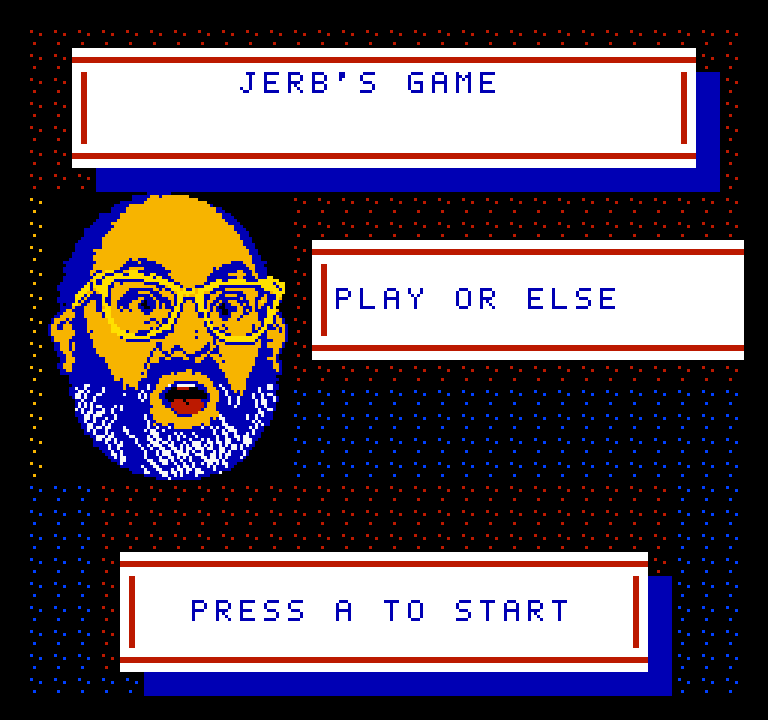
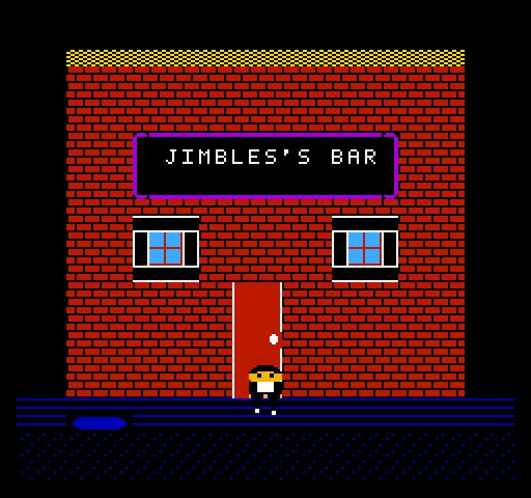
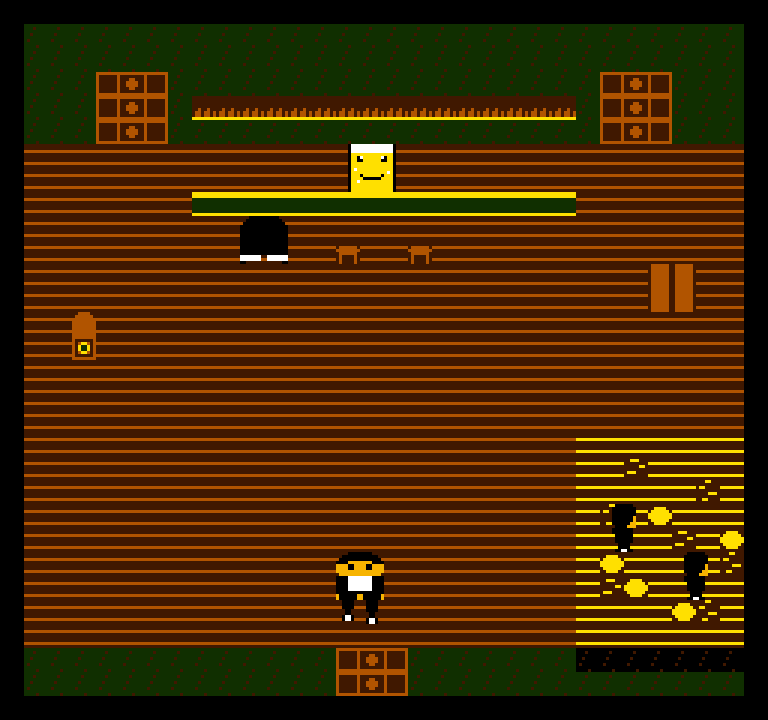
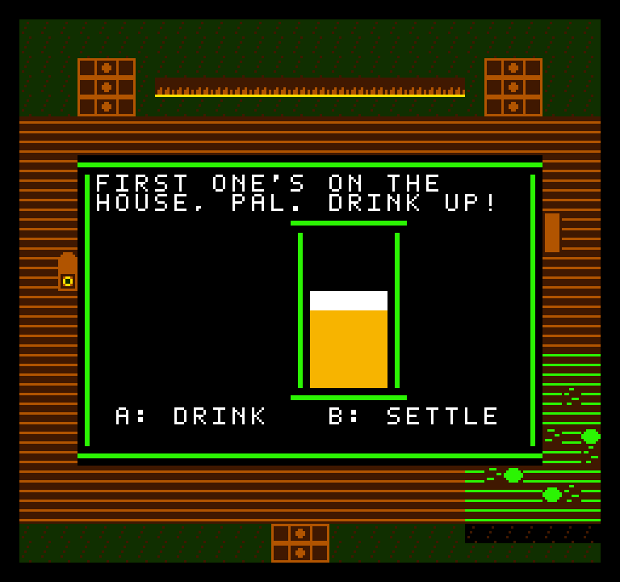
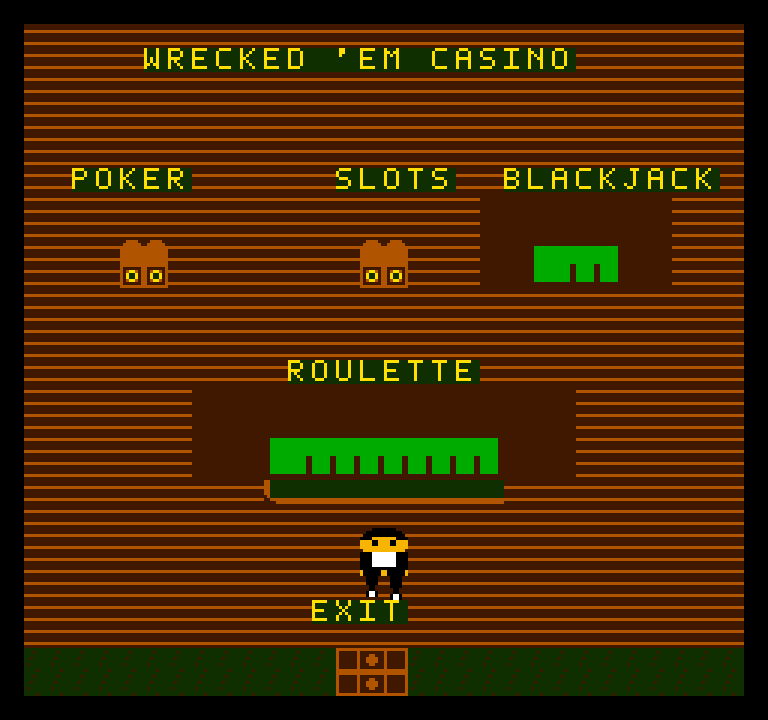
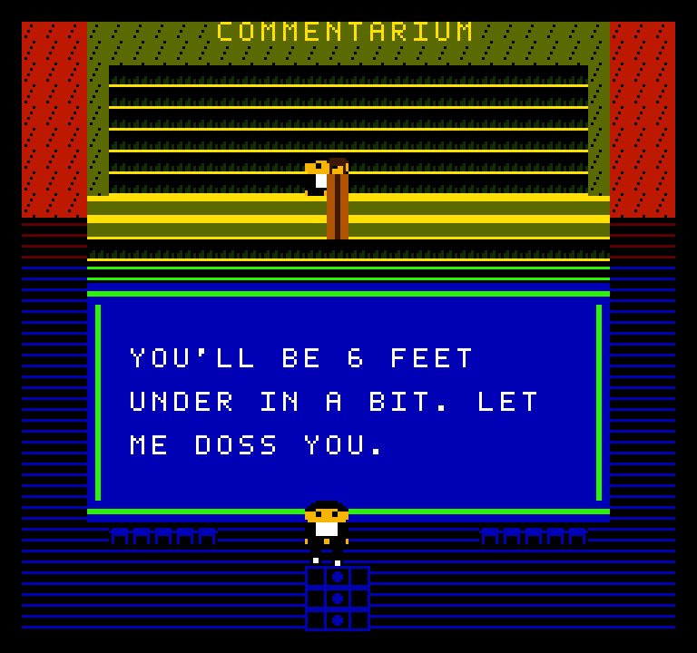
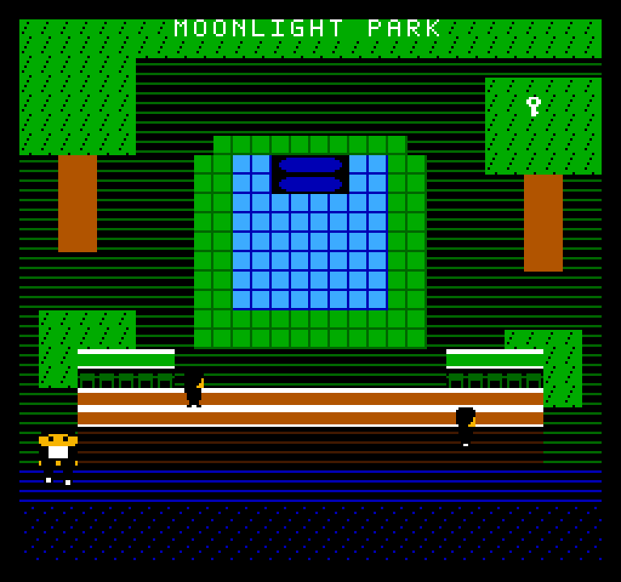
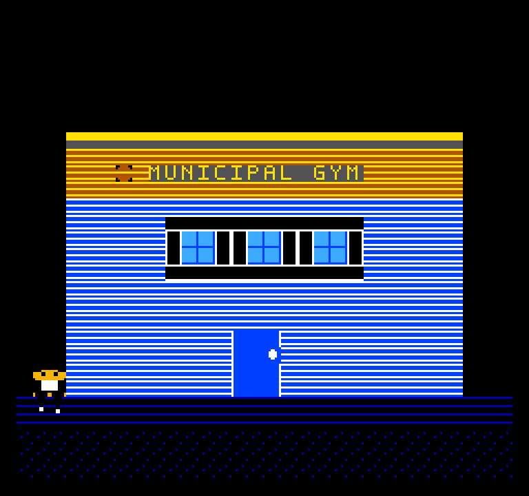
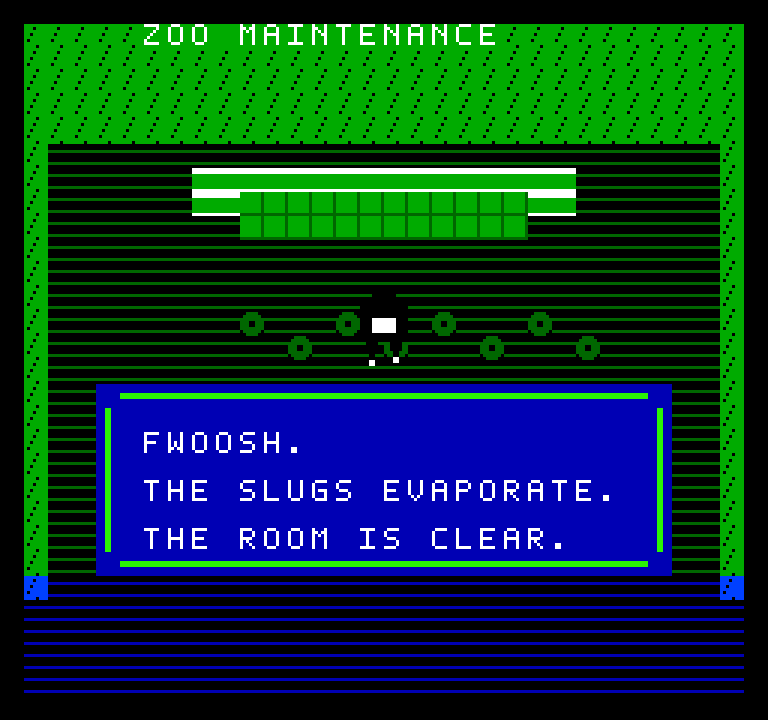

<h1 align="center">Jerb's Game</h1>
<p align="center"><em>One strange night in a neon town, on a real NES cartridge.</em></p>

<p align="center">
  
</p>

<p align="center">
  
  
  
  
  
</p>

Jerb's Game is an adventure-comedy homebrew for the Nintendo Entertainment System. You walk a small town after dark: a dive bar run by a sentient pint of beer, a casino in its back room, a convenience store that sells flamethrowers behind the mops, a sewer, and a zoo that is definitely, absolutely closed for routine maintenance. Talk to people, win a chugging contest, gamble, and deal with the slugs.

It's written in C and 6502 assembly with [cc65](https://cc65.github.io/) and targets a real MMC3 cartridge layout (512 KiB PRG, 256 KiB CHR), so it runs in any accurate NES emulator and is built to the same limits as real hardware.

> Contains crude language and adult humor.

## Screenshots

| | |
| --- | --- |
|  |  |
| **Neon Avenue**, the hub. Mind the road. | **Jimbles's Bar** and its infamous corner. |
|  |  |
| **The chugging challenge.** Drink too fast and it spills, wait too long and it goes warm. | **Wrecked 'Em Casino**: slots, blackjack, video poker, roulette. |
|  |  |
| **The Commentarium**, where the audience reads its worst comments. | **Moonlight Park.** Somebody stole the water. |
|  |  |
| **Municipal Gym**, home of a future 1-on-1 game. | **Pocket Zoo.** It needed something very hot. |

## The town

| Location | What's there |
| --- | --- |
| Neon Avenue | The central street. Doors to the bar, the Mart to the west, the park to the east, and a manhole. The road is not a sidewalk. |
| Jimbles's Bar | Jimbles, his chugging challenge, a jukebox, a patron who only grunts, and Piss Corner's banished regulars. |
| Wrecked 'Em Casino | Behind the bar's locked back door. Slots with a wild BAR, blackjack with naturals, single-deck video poker, and an American roulette wheel, all on one cash balance. |
| The Commentarium | A side room off the bar. Performers take the mic and read comments that should not have been posted. |
| All-Nite Mart | A store with a cashier, a register, and some surprising stock. |
| Pawn Shop and Laundromat | A side street west of the Mart. Both are not open yet. |
| Galaxy Lanes & Arcade | North of the side street. Exterior only so far. |
| Municipal Gym | East of the arcade, with a court, a coach, and two gym rats. |
| Moonlight Park | A dry fountain, wandering regulars, and something hidden in a treetop. |
| Sewer | Under the manhole: a ladder shaft and a tunnel east. |
| Pocket Zoo | Through the sewer's service hatch: a slug-filled maintenance building, Keeper Nibs, a pond, and a reptile house. |

[WORLD_MAP.md](WORLD_MAP.md) has the full map, including planned destinations.

## Controls

| Button | Action |
| --- | --- |
| D-pad | Walk. Walk into a doorway or off a screen edge to go there. |
| A | Talk, inspect, or play whatever you're standing at. Also advances text. |
| B | Leave a casino table, or let the foam settle in the chugging challenge. |
| Start | Open the inventory. A describes an item; B or Start closes it. |

At the slots, blackjack, and poker tables, Left and Right change the bet. At roulette, the D-pad moves the marker and Select changes the bet.

## Building

The build scripts are Windows batch files.

**You need:**

- [cc65](https://cc65.github.io/) installed at `C:\tools\cc65`. The scripts set that path themselves. Tested with the V2.19 snapshot.
- Python 3 on your `PATH`. The build uses only the standard library.
- [Mesen 2](https://www.mesen.ca/), if you want `run.bat` to launch the game: `winget install --id SourMesen.Mesen2 -e`

**Then, from the repository root:**

```bat
build.bat
```

That writes `game.nes` to the repository root. A full build takes about 10 seconds.

```bat
run.bat
```

`run.bat` builds the ROM and opens it in Mesen. Any accurate emulator that supports mapper 4 also works.

```bat
test.bat
```

`test.bat` compiles the hardware-independent modules for cc65's `sim6502` target and runs them in `sim65`, including the casino rules, the chugging-challenge rules, the VRAM queue, and the RNG. It also runs the cartridge packer's Python tests. Anything involving the PPU, sprites, the mapper, or timing still needs an emulator.

> **Current state:** this is a work-in-progress prototype. The `main` branch has a temporary test start in `src/v2_title_main.c` that drops you at the Municipal Gym after the title screen. Walk west from there to reach the rest of town.

## How it's built

- **A fixed engine plus banked scenes.** The engine lives in the two fixed MMC3 PRG banks (62–63): reset, NMI, music, input, dialogue, inventory, and game state. Each location is its own independently linked 16 KiB module in a pair of switchable PRG banks. The engine maps a pair in, calls it through a trampoline, and the scene returns an exit code to the dispatcher.
- **Explicit bank allocation.** [`assets/banks/manifest.json`](assets/banks/manifest.json) assigns every PRG and CHR bank. `tools/pack_mmc3.py` assembles the cartridge from it deterministically and writes `build/bank_report.txt`. Every scene build checks its own 16 KiB budget, and the fixed engine checks its shared budget.
- **Per-location graphics.** Several locations get their own CHR bank, generated by small Python scripts in `tools/` that patch new tiles into the common set.
- **No VRAM writes while the screen is drawing.** Full-screen redraws happen with rendering switched off. Small in-game changes (typed dialogue, casino readouts, the arcade marquee) go through a queue that the NMI drains during vblank. Sprites are composed in a RAM shadow buffer and DMA'd once per frame.
- **NMI-clocked music.** The sound engine runs in the NMI handler. Songs live in their own PRG bank and are copied to RAM when a scene starts, so the interrupt never switches banks.

[CURRENT_ARCHITECTURE.md](CURRENT_ARCHITECTURE.md) covers all of this in detail, along with budgets and constraints.

## Repository layout

| Path | Contents |
| --- | --- |
| `src/` | Game source. `v2_scene_*.c` are the locations, `v2_*.c` the shared engine, `startup.s` the reset and NMI code. `main.c`, `room.c`, `movement.c`, `quest.c`, and `world.c` belong to the archived prototype and aren't linked into the ROM; they're kept for reference, and all but `main.c` are still exercised by `test.bat`. |
| `src/scenes/` | Assembly entry stubs, one per banked scene. |
| `cfg/` | ld65 linker configs for the fixed engine and the scene banks. |
| `tools/` | Python generators (CHR banks, music, dialogue, font), budget checkers, and the cartridge packer. |
| `assets/` | The bank manifest, title portrait art, and title speech text. |
| `music/` | Source material for the bar and title themes. |
| `txt/` | Editable text data, such as the Commentarium's comments. |
| `tests/` | Host-side tests run by `test.bat`. |
| `docs/screenshots/` | The images in this README. |
| `archive/` | A snapshot of the earlier action-RPG prototype this project grew out of. |

## Editing content

- **Title speech:** `assets/title_messages.txt`. The build regenerates `src/title_messages.s` from it.
- **Commentarium comments:** `txt/dumbcomments.txt`, one comment per line, up to 63 characters. The build wraps them into three 21-character lines and regenerates `src/dumb_comments_data.h`.
- **New locations:** reserve PRG and CHR banks in `assets/banks/manifest.json`, add a `build_scene_*.bat`, and follow [ROUTING.md](ROUTING.md) for exits and spawns.
- **Text:** the font covers `A–Z`, `0–9`, and `! ' , . : ?`. Lowercase is folded to uppercase, and any other character draws as a blank. Dialogue lines fit 21 characters.

## Documentation

| Document | Covers |
| --- | --- |
| [CURRENT_ARCHITECTURE.md](CURRENT_ARCHITECTURE.md) | The runtime as it is today: banking, engine services, budgets, constraints. |
| [ROADMAP.md](ROADMAP.md) | Direction, experience pillars, the town blueprint, and open work. |
| [WORLD_MAP.md](WORLD_MAP.md) | Town geography and expansion order. |
| [DESIGN_CATALOG.md](DESIGN_CATALOG.md) | Candidate locations, characters, items, and puzzles. |
| [MAPPER.md](MAPPER.md) | The MMC3 cartridge layout and bank rules. |
| [ROUTING.md](ROUTING.md) | Scene routes and spawn points. |

These are design history from the move to banked scenes and may be out of date: [REBUILD_ROADMAP.md](REBUILD_ROADMAP.md), [BANKING_MIGRATION.md](BANKING_MIGRATION.md), [BANKED_DISPATCHER.md](BANKED_DISPATCHER.md), [BANKED_SCENES.md](BANKED_SCENES.md), and [ARCHITECTURE_REVIEW.md](ARCHITECTURE_REVIEW.md), which reviews the archived prototype.

## Credits

Made by [jbax-and-his-ai-pals](https://github.com/jbax-and-his-ai-pals), partly as an experiment in how far AI-assisted development can go on a small, fixed target.

## License

No license is granted. All rights reserved.
